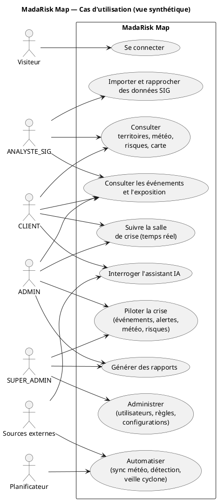

# Diagramme de cas d'utilisation UML — MadaRisk Map

Code **PlantUML** du diagramme de cas d'utilisation du projet. Généré à partir des
rôles (`SUPER_ADMIN / ADMIN / ANALYSTE_SIG / CLIENT`), des routeurs
(`backend/src/routes/*`) et du contrat `openapi.yaml`.

Le fichier contient deux vues :

1. **Vue globale** — tous les cas d'utilisation, regroupés par domaine, avec les
   acteurs secondaires (planificateur, sources externes).
2. **Vue synthétique** — version compacte pour une diapositive.

---

## 1. Vue globale

```plantuml
@startuml madarisk_use_cases_global
title MadaRisk Map — Diagramme de cas d'utilisation (vue globale)
left to right direction
skinparam packageStyle rectangle
skinparam shadowing false

' ── Acteurs ────────────────────────────────────────────────────────────────
actor "Visiteur" as Visiteur
actor "Utilisateur authentifié" as User
actor "CLIENT" as CLIENT
actor "ANALYSTE_SIG" as ANALYSTE
actor "ADMIN" as ADMIN
actor "SUPER_ADMIN" as SUPERADMIN
actor "Planificateur\n(node-cron)" as CRON
actor "Sources externes\n(Open-Meteo, DGM Maproom,\nGDACS, IBTrACS, Gemini)" as EXT

CLIENT --|> User
ANALYSTE --|> User
ADMIN --|> User
SUPERADMIN --|> ADMIN

' ── Système ────────────────────────────────────────────────────────────────
rectangle "Système MadaRisk Map" {

  package "Authentification & comptes" {
    usecase "S'authentifier" as UC01
    usecase "Renouveler la session" as UC02
    usecase "Se déconnecter" as UC03
    usecase "Consulter son profil" as UC04
    usecase "Changer son mot de passe" as UC05
    usecase "Gérer les utilisateurs" as UC06
  }

  package "Référentiel territorial" {
    usecase "Consulter le référentiel\n(districts / communes)" as UC07
    usecase "Rechercher un territoire" as UC08
    usecase "Afficher les couches cartographiques" as UC09
  }

  package "Imports & rapprochement" {
    usecase "Importer un fichier SIG\n(GeoJSON / JSON / CSV)" as UC10
    usecase "Rapprocher les enregistrements\n(matching)" as UC11
    usecase "Valider le rapprochement" as UC12
  }

  package "Événements & exposition" {
    usecase "Consulter les événements" as UC13
    usecase "Gérer les événements\n(créer / modifier / statut)" as UC14
    usecase "Supprimer un événement" as UC15
    usecase "Gérer les trajectoires" as UC16
    usecase "Consulter la situation à un instant t\n(état, impacts, alertes)" as UC17
    usecase "Calculer une zone d'influence" as UC18
    usecase "Calculer l'exposition" as UC19
    usecase "Consulter les communes exposées" as UC20
  }

  package "Météo" {
    usecase "Consulter la météo\n(cartes, prévisions, historique)" as UC21
    usecase "Synchroniser la météo" as UC22
    usecase "Ingérer la DGM Maproom" as UC23
  }

  package "Risques" {
    usecase "Consulter les risques" as UC24
    usecase "Recalculer les risques" as UC25
    usecase "Gérer les configurations de risque" as UC26
  }

  package "Détection & alertes" {
    usecase "Gérer les règles de détection" as UC27
    usecase "Lancer la détection de dangers" as UC28
    usecase "Générer les alertes automatiques" as UC29
    usecase "Gérer les alertes\n(créer / publier / archiver)" as UC30
    usecase "Consulter les alertes" as UC31
  }

  package "Tableau de bord & rapports" {
    usecase "Consulter le tableau de bord" as UC32
    usecase "Générer / exporter un rapport\n(CSV / GeoJSON / PDF)" as UC33
    usecase "Télécharger un rapport" as UC34
  }

  package "Assistant IA" {
    usecase "Dialoguer avec l'assistant IA\n(réponse directe ou en flux SSE)" as UC35
    usecase "Gérer ses conversations\n(consulter / supprimer)" as UC36
  }

  package "Temps réel & automatisation" {
    usecase "Suivre la salle de crise\n(flux temps réel SSE)" as UC37
    usecase "Veiller sur les cyclones" as UC38
  }

  package "Supervision" {
    usecase "Superviser la santé du système" as UC39
  }
}

' ── Relations acteur principal → cas d'utilisation ─────────────────────────
Visiteur --> UC01

User --> UC02
User --> UC03
User --> UC04
User --> UC05
User --> UC07
User --> UC08
User --> UC09
User --> UC13
User --> UC17
User --> UC20
User --> UC21
User --> UC24
User --> UC31
User --> UC32
User --> UC34
User --> UC35
User --> UC36
User --> UC37

ANALYSTE --> UC10
ANALYSTE --> UC11
ANALYSTE --> UC12

ADMIN --> UC14
ADMIN --> UC16
ADMIN --> UC18
ADMIN --> UC19
ADMIN --> UC22
ADMIN --> UC23
ADMIN --> UC25
ADMIN --> UC28
ADMIN --> UC29
ADMIN --> UC30
ADMIN --> UC33

SUPERADMIN --> UC06
SUPERADMIN --> UC15
SUPERADMIN --> UC26
SUPERADMIN --> UC27

' ── Acteurs secondaires ────────────────────────────────────────────────────
CRON --> UC22
CRON --> UC23
CRON --> UC25
CRON --> UC38

EXT --> UC22
EXT --> UC23
EXT --> UC35
EXT --> UC38

' ── Relations entre cas d'utilisation ──────────────────────────────────────
UC11 .> UC10 : <<include>>
UC12 .> UC11 : <<extend>>
UC18 .> UC19 : <<include>>
UC28 .> UC29 : <<include>>
UC30 .> UC31 : <<extend>>
UC33 .> UC34 : <<extend>>
UC07 .> UC09 : <<extend>>

note bottom of EXT
  Acteurs secondaires :
  - Open-Meteo : prévisions / observations
  - DGM Maproom : cumuls de pluie décadaires
  - GDACS / IBTrACS : veille cyclonique
  - Gemini : génération des réponses IA
end note

note bottom of CRON
  Jobs planifiés (node-cron) :
  météo, purge horaire, recalcul des risques,
  ingestion DGM, veille cyclone.
end note

note bottom of UC35
  Le modèle (Gemini) peut réclamer des outils internes
  (territoires, événements, risques, alertes, météo) :
  function calling borné à UN aller-retour, exécuté
  côté serveur, sans jamais exposer d'identifiants
  au modèle. Les données manquantes ne sont pas inventées.
end note
@enduml
```

---

## 2. Vue synthétique

