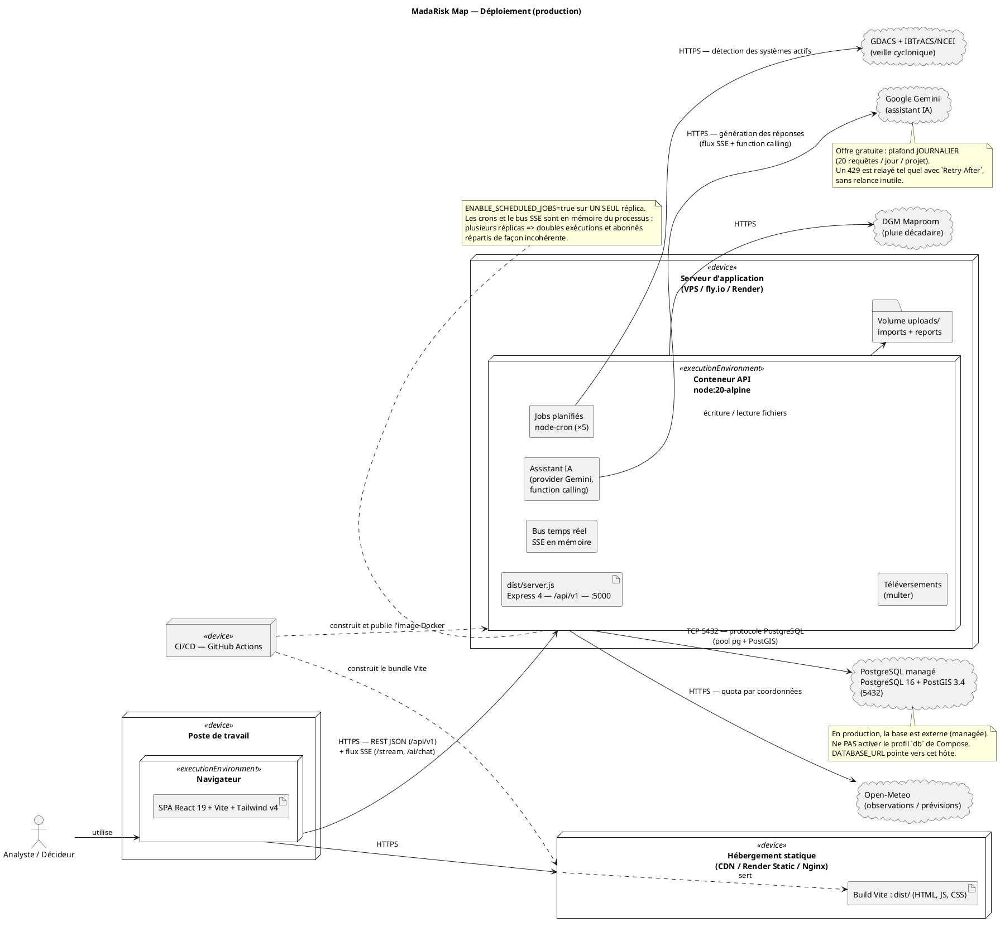
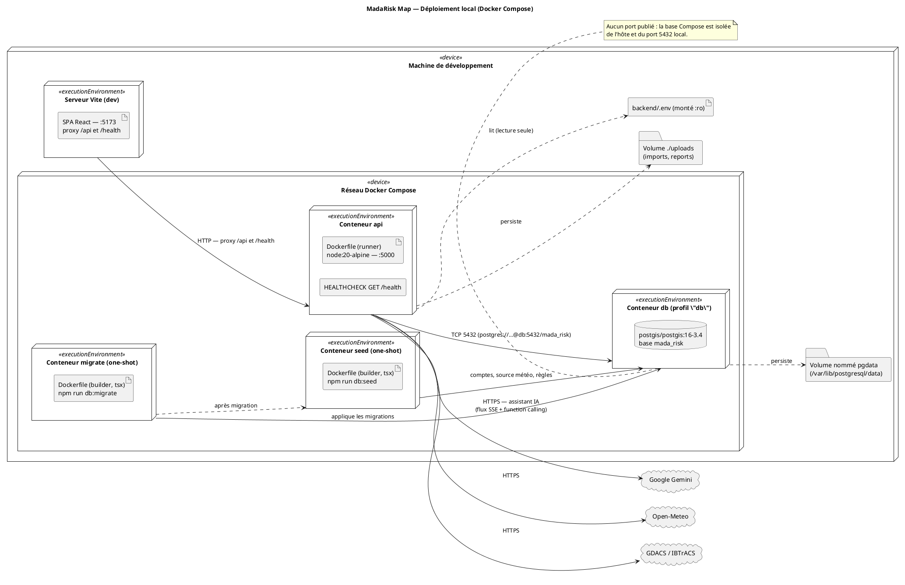
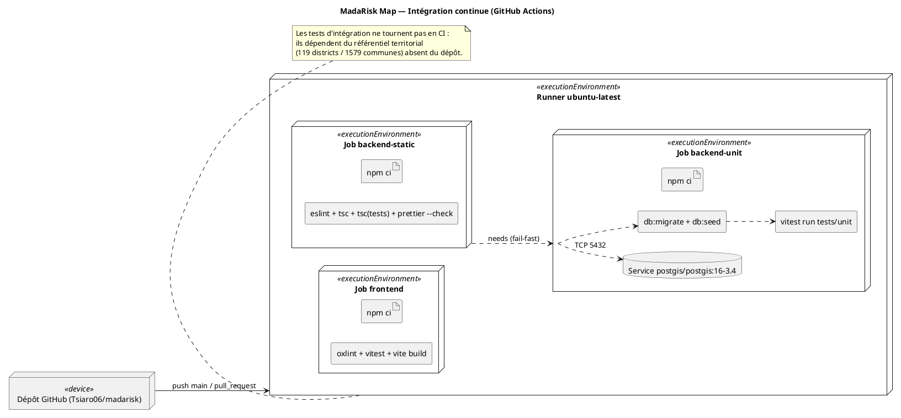

# Diagramme de déploiement UML — MadaRisk Map

Code **PlantUML** du diagramme de déploiement. Établi à partir de
`backend/Dockerfile`, `backend/docker-compose.yml`, `backend/docs/deployment.md`,
`frontend/vite.config.ts`, `backend/src/config/env.ts` et des jobs planifiés.

Le fichier contient trois vues :

1. **Production** — API conteneurisée + PostgreSQL/PostGIS managé + SPA statique.
2. **Locale (Docker Compose)** — pile éphémère de développement.
3. **Intégration continue** — GitHub Actions.

---

## 1. Production

---

## 2. Locale (Docker Compose)

---

## 3. Intégration continue (GitHub Actions)

